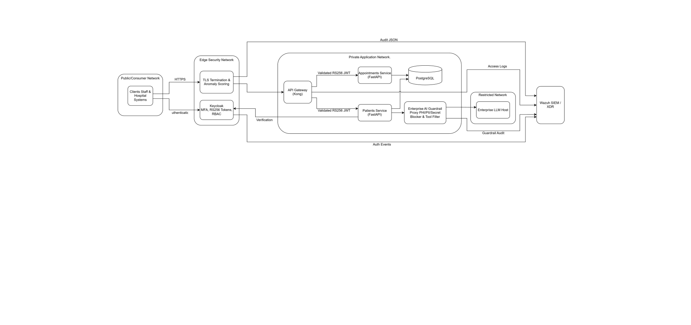

# Savannah Informatics: Information Security Analyst Technical Assessment

Technical assessment submission for the Information Security Analyst role at Savannah Informatics. This repository contains the complete architectural blueprints, comprehensive written answers, runnable reference implementation, security testing pipelines, SIEM correlation rules, and verified execution evidence.

## Assessment Navigation

| Assessment Section          | Topic                                              | Primary Deliverables                                                                                                                           | Supporting Code & Configs                                                                                                                                                           |
| --------------------------- | -------------------------------------------------- | ---------------------------------------------------------------------------------------------------------------------------------------------- | ----------------------------------------------------------------------------------------------------------------------------------------------------------------------------------- |
| **Section 1A (a)**    | Architecture & Threat Boundaries                   | [`docs/architecture.md`](file:///b:/Projects/SIL-Assessment/docs/architecture.md)                                                             | Image of System diagram & zone models                                                                                                                                              |
| **Section 1A (b–f)** | WAF, API Gateway, Auth, AI Guardrails, Risks       | [`docs/01-section1A-api-gateway-and-ai-guardrails.md`](file:///b:/Projects/SIL-Assessment/docs/01-section1A-api-gateway-and-ai-guardrails.md) | [`infra/`](file:///b:/Projects/SIL-Assessment/infra), [`services/`](file:///b:/Projects/SIL-Assessment/services), [`guardrails/`](file:///b:/Projects/SIL-Assessment/guardrails) |
| **Section 1B (1–6)** | SIEM, DAST, SAST, Secrets, SCA, SDLC               | [`docs/02-section1B-siem-dast-sast-secure-ai-sdlc.md`](file:///b:/Projects/SIL-Assessment/docs/02-section1B-siem-dast-sast-secure-ai-sdlc.md) | [`siem/`](file:///b:/Projects/SIL-Assessment/siem), [`ci/`](file:///b:/Projects/SIL-Assessment/ci), [`.github/workflows/`](file:///b:/Projects/SIL-Assessment/.github/workflows) |
| **Section 2 (a–g)**  | Softskills, Simulated Incident Report, Safe Harbor | [`docs/03-section2-softskills-and-policy.md`](file:///b:/Projects/SIL-Assessment/docs/03-section2-softskills-and-policy.md)                   | One-page PHI-to-ChatGPT report, DPA Sec. 43/63                                                                                                                                      |

## System Architecture Diagram



> **Interactive Diagram Links:**
>
> * 🔗 [Open Interactive Diagram in diagrams.net (draw.io)](https://app.diagrams.net/?tags=%7B%7D&lightbox=1&highlight=0000ff&edit=_blank&layers=1&nav=1&title=SavannahTechnical.drawio&dark=auto#R5Vxbc9o4FP41zOw%2BxGNJvj4SmlubtLRkmu6%2B7DhGATfGYmSRhP76lbAMyDhcjAUe8pLggyTj7zs659ORoIU6o7crGoyHd6SP4xY0%2B28t9KkFIfQcj%2F8TlmlmASZEmWVAo760LQy96A%2FOG0rrJOrjVGnICIlZNFaNIUkSHDLFFlBKXtVmTyRW7zoOBnjF0AuDeNX6EPXZMLN60F3Yr3E0GOZ3Bo6fvTMK8sbySdJh0CevSyZ00UIdSgjLXo3eOjgW6OW4%2FDv%2BejUdJ8POi205TvRwhX6enWWDXe7SZf4IFCes8tD%2FJTffhzfh9eXX9Bv4fH2XPn6hZ%2F6WQ8uPkLJpjislk6SPxdighc5fhxHDvXEQindfuStx25CNYvm2bNzFNBphhqk0Z4O%2BBPFEDioNmDL8tkSffKArTHhvOuVNhgplVtbvdcEvcIBhZ1Y5kOdIv5WOjFDuZNLBBvPRFyDyFxLHHTC1TgBTaJtbYHoGkKmACk1TE6jbzoEmgwq2A9UyLQPaKq6Osz%2BupXjBE8AV%2Bqu4Oo6poApc1VOBX4OnliIlwwzur%2BSlLSEmExriNe2sFSrEvXryklA2JAOSBPHFwnq%2BIMvkV4s2t4SMJRe%2FMWNTmb%2BDCSMqgfgtYr%2BWXv8jhjIsefXpTY48u5jmFwnH89fyRdbLzi8X3WZXeT%2BpEgI6wOvwcso9g%2BI4YNGLCn4%2Bt0zDtBz4PvOz4dqUBtOlBmMSJSxdultXGJZGnUuEeW5x1VS8qQP07YLfZZ9h4YXzB6zumA3LS504wjNYzR4Lnp5aAhInGInRsr%2Fcck3SccQC8Wi9acrwKK0UINzV%2BOCr4eEMOZ6hxlxk%2BpoihH3aEcIwkadECcd2jxkngFnuIaWBQmNQsHla3y0soJrDQqmyypOuPnd0mpOwoF3JE2FdrugewxWdQrJx7bVuWGieq9b3mgNz3w7IQoan39GRc9qOzuMuUpzddo8ad3fxdekaXJ45vmb3R6apetvGDrJSoFWcOc0SZ%2Fe3PW64x3QUJZwtkpTKs3ZCRkEsuOiFhEbJoJI680pWxbAgz4Dpr6yJbXt%2FfVaeEbUv4dzmZET3yBnxHQfRmxERKGozZYpvbu%2BbrTpDQrkbWh%2FIDSsKs7q8EDXCC8FuXpiva7UmJndHn9OcmNrdG264Chh%2BnWH91xeSDP6uLe%2BYhaqhD1XE14mT%2FXKOqXuy587ThNleMel44BjrsIU2BWBNSagObWoBaOy0OLPBjmutnTtYcE2QWe0OrPL7zRHJuJHdCpOmhnCV364p8eoLnoYxCZ65eI75xznvRy%2F85UC8vLtstyB%2FSvNHD9qOkNvkGSeptJ23O3kfDsRSt0qxrqQCuo3GRk6Bvfr283zt8W6V4QPGO7NavDN831VjngX9I5RBl9bjbs0hz18bXzY1P4zy1l6hP65z1iK93Q1u%2BXsyGufPk5AEl3pqKfzeDo5avxBzPxL3x111WQciei0NTVEKJQqhy2HI90gxfYn4HfiK5zJIGV8G%2FV2jPHA2ywPL9tVA7Gorv2mv0wP08WbgUSPtWhaaMgHb45l0GRVn3Mq0bMgMhJYucQ71i%2FMGHWLaWv8YJoDqNEQWqikV%2BsfUPEh%2F8alBfFcsPrlHrT1B00Pvs19pIebZxZXY%2BtLTSnt3UynJ2rcDAAYqeLeGEjdo2Mm4i4S%2FOaZRKuRee1bvngS0T4NIPEqXkjdBc%2Feav3PZvRF%2FezikWCB5HpPwmY9ctlt7T4jofxnF4t5VklRZxdxWk5SzUkGqQSaumUfNYe0h%2BDMZCt1wc3E3w%2F%2BS%2F%2F316UclpAGyV6Eubk7MDfP9I11nmvNqXVOwVmbI7a3A%2B5qkTJfy8jxkuIfy651z7wJr%2FthMBbQM75RR8ow7JCYCX1maeYriuGAK4miQ8MsQJzMqzgWwURjEbfnGKOr3SxL1CltdGr0EbBbMxuOYjyAPlHzF7JXQZ6MSbWiVNgd56gTxoMJZLWf%2BywXzyVE2eeREcSw6JEkno1lGkXTVxdYBv%2FlSypl9apwJ6Txbt4YTGrHpQRg73BfAqh%2BQayhd1%2Ff33V5toa%2BwlwffOSpSPy%2FVVVhDeWlP2JCPMU9ThyEIactNXmWC0mEwFi%2FDaRxxxOhm%2FfaYQXv7ODcE4fNgBvi3CeOj4PcUXZfLtwHFve%2B3lRDfYn%2FbKSwuIdJVwN7jDEJD58QPzG8ZhYy3qD%2BrFFaQ858cyGcG1KUATk9pi9jFLRcvWFZ%2B6iDIVfmxC5HLNi1d%2FFQPXY3lpx%2BJMs3n3revddHjFegpKDKQo1h%2F1fjkps9ymU1SVQ9HhW%2Bb%2BoXCjeWsqe3ux1H1PbaGctQOQ5yK%2FblbMqgtxBXmkF%2F8ejbUxo%2BsHHyIM%2F56trrFOSPxIWjYUg8dZZbs8bXsypyZBrD9uo8EF7dZCl8%2F29gebvz6ZVEI79oBua5xgC8mo%2BrbMg2NXT8xjZ70Lix99VeOLKBLPKOTW%2Fj%2F5CP1g2yNkx%2FJ%2FvxwXxdRxfUoAipV0Fpz0nY%2Fqk5ORx%2BZKpRvLOxAFb9c%2FFRcFiIXv7iHLv4H)
> * 🖼️ High-Res Formats: [Vector SVG](SavannahTechnical-Detailed.drawio.svg) | [Raster PNG](SavannahTechnical-Detailed.drawio.png)

## Running & Verifying the Solution

The reference stack is containerized with Docker Compose. Both **PowerShell** (Windows) and **Bash** (Linux/macOS) execution scripts are provided.

### 1. Launch the Stack

```powershell
# Windows (PowerShell)
cd infra
if (-not (Test-Path .env)) { Copy-Item .env.example .env }
docker compose up -d --build
cd ..
```

```bash
# Linux / macOS (Bash)
cd infra && cp -n .env.example .env && docker compose up -d --build && cd ..
```

* **WAF Endpoint:** `http://localhost:8081` (proxies to Kong on port 8000)
* **Keycloak IdP:** `http://localhost:8080` (realm: `savannah`, client: `sil-api`)
* **AI Guardrail Proxy:** `http://127.0.0.1:8090` (upstream: `mock-llm:9000`)

### 2. Execute Automated Demonstration & Evidence Suite

Run the full end-to-end evidence generator (authentication, RBAC masking, WAF attack blocking, rate limiting, and AI input/output guardrails):

```powershell
# Windows (PowerShell)
powershell.exe -ExecutionPolicy Bypass -File .\scripts\demo.ps1
```

```bash
# Linux / macOS (Bash)
./scripts/demo.sh
```

### 3. Run Static Security & AI Quality Checks

```bash
# A. Guardrails Unit & Integration Test Suite (16 passing tests)
pytest -v guardrails/tests

# B. AI-Hallucinated Dependency Gate (Should FAIL on hallucinated packages)
python ci/scripts/check_dependencies.py demo/requirements-ai-generated.txt

# C. Semgrep AI Logic Flaw Scanner (Detects 6 subtle AI flaws on demo file)
docker run --rm -v "${PWD}:/src" semgrep/semgrep semgrep --config /src/ci/semgrep/ai-logic-flaws.yml /src/demo/

# D. Semgrep Scan on Real Production Services (0 findings expected)
docker run --rm -v "${PWD}:/src" semgrep/semgrep semgrep --config /src/ci/semgrep/ai-logic-flaws.yml /src/services/
```

## Verified Evidence & Test Outputs

All test suites and attack scenarios have been executed and verified in this environment. Raw outputs are saved in the [`evidence/`](file:///b:/Projects/SIL-Assessment/evidence) directory:

1. **End-to-End Demo Output:** [`evidence/demo_output.txt`](file:///b:/Projects/SIL-Assessment/evidence/demo_output.txt)
   * `401 Unauthorized` for missing/forged tokens.
   * `200 OK` for clinician token; `403 Forbidden` for receptionist accessing restricted endpoints.
   * Role-based PHI masking: Receptionist sees `{"national_id": "****678"}` with diagnosis omitted.
   * `403 Forbidden` from ModSecurity OWASP CRS on SQL Injection (`OR 1=1--`), XSS (`<script>alert(1)</script>`), and scanner user-agent (`sqlmap/1.7`).
   * `422 Unprocessable Entity` on Pydantic schema validation failures.
   * `400 Bad Request` from WAF buffer limit on oversized payloads (>128 KB).
   * `429 Too Many Requests` triggered at request 31 by Kong rate-limiting plugin.
   * `400 Bad Request` from AI Guardrail proxy blocking Kenyan National ID, DB connection strings, and prompt injection attempts.
   * Outbound LLM response sanitization: stripping Kenyan phone numbers, emails, credit cards, hostile markdown images, and unapproved tool calls (`delete_all`).
2. **ModSecurity JSON Audit Evidence:** [`evidence/waf_audit_modsecurity.json`](file:///b:/Projects/SIL-Assessment/evidence/waf_audit_modsecurity.json)
3. **Guardrails Pytest Log:** [`evidence/guardrails_pytest.txt`](file:///b:/Projects/SIL-Assessment/evidence/guardrails_pytest.txt)
4. **Semgrep Findings Report:** [`evidence/semgrep_scan_results.txt`](file:///b:/Projects/SIL-Assessment/evidence/semgrep_scan_results.txt)
5. **Dependency Integrity Report:** [`evidence/dependency_checker.txt`](file:///b:/Projects/SIL-Assessment/evidence/dependency_checker.txt)
